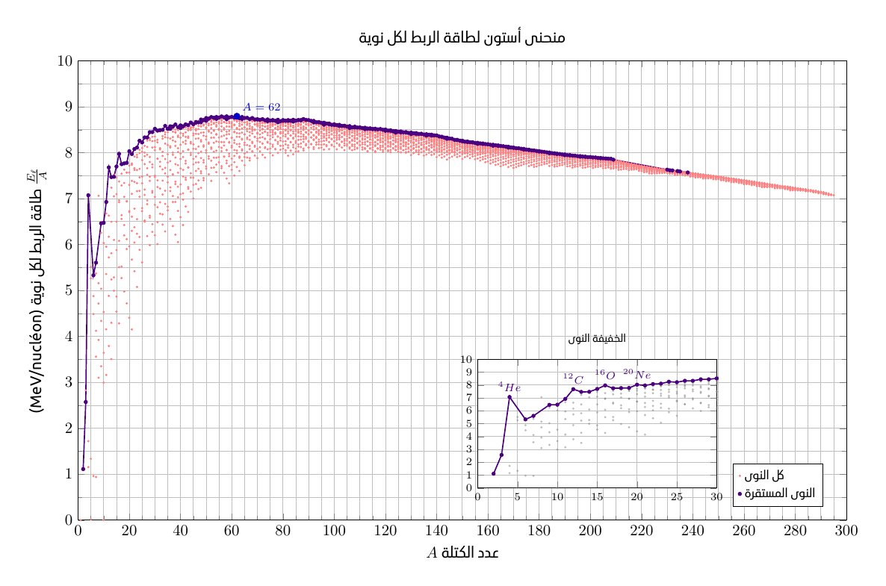

# Aston curve

A TikZ/PGFPlots chart of nuclear binding energy per nucleon against mass
number, with a separate view of light nuclei.



## Build

Compile from this directory using XeLaTeX:

```sh
xelatex -interaction=nonstopmode -halt-on-error diagramme_Aston.tex
```

The document requires the LaTeX packages `standalone`, `pgfplots`,
`fontspec`, `polyglossia`, `xcolor`, and `lmodern`, plus the Ubuntu Arabic
font. The result is `diagramme_Aston.pdf`.

## Data

- `A,Z,N,Binding Energy per Nucleon [MeV].csv`: binding energies used for
  the full set of plotted nuclei.
- `noyaux_stables_energie.csv`: binding energies for the stable series,
  joined on proton number `Z` and neutron number `N`, sorted by mass number.
- `noyaux_stables.csv`: the original stable-nuclei list used for that join.

Both CSV files read by the TeX source must remain next to it.
